ps：这是第一次样本分析，主要记录分析过程及其原理，借鉴大佬的思路，写的会比较像流水账，还请见谅。等后面做的多了再浓缩文章


文章参考https://www.52pojie.cn/thread-1585120-1-1.html

（SHA256) 8ff43b6ddf6243bd5ee073f9987920fa223809f589d151d7e438fd8cc08ce292


环境是win10虚拟机，断网，配好一系列工具

在 https://bazaar.abuse.ch/sample/8ff43b6ddf6243bd5ee073f9987920fa223809f589d151d7e438fd8cc08ce292/ 下载样本

## 技巧分析

### 在线网站情报

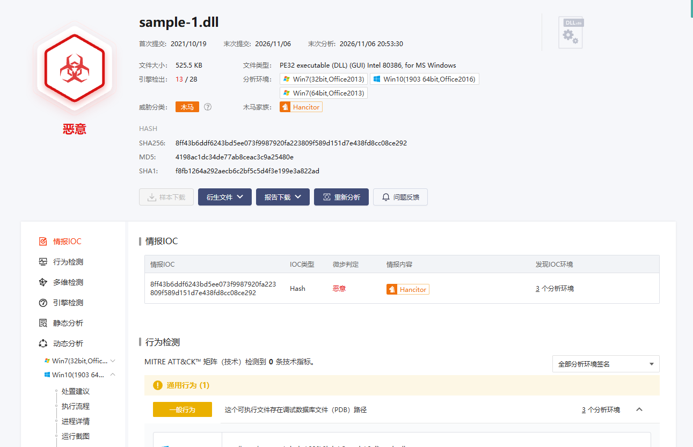

是Hancitor下载器样本，重点需要观察联网、脱壳之后做了什么

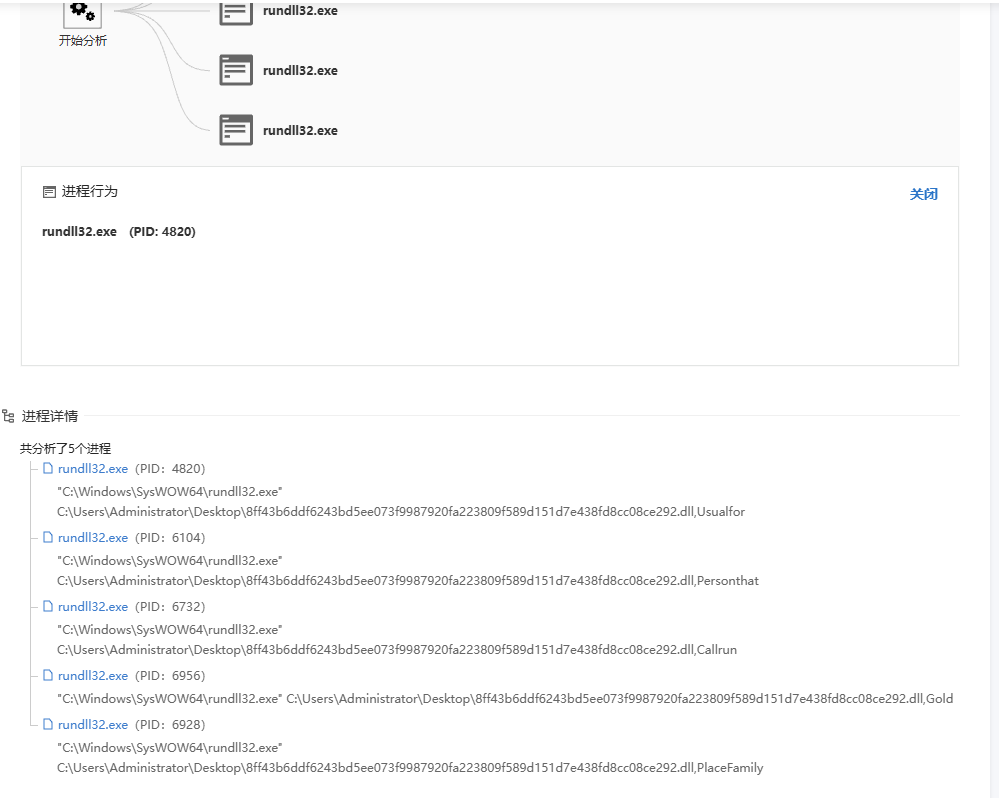

沙箱对导出函数好像并没有分析出什么，得自己看了


### 导入表

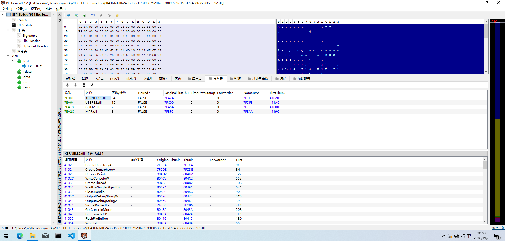

和网络相关的DLL只有**MPR.dll**，但他主要用于**局域网共享、映射网络驱动器**，而不是用于互联网通信

可以猜测和C2联系有关的dll被隐藏了

### 导出函数

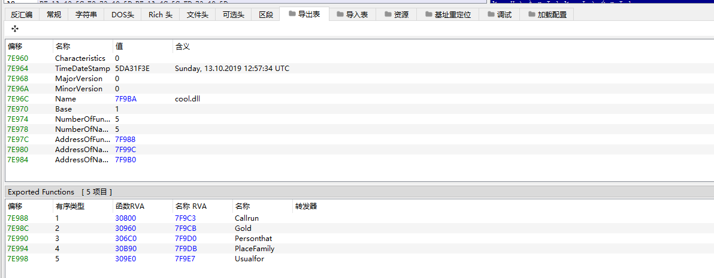

### 节表

看节表及其地址大小等信息

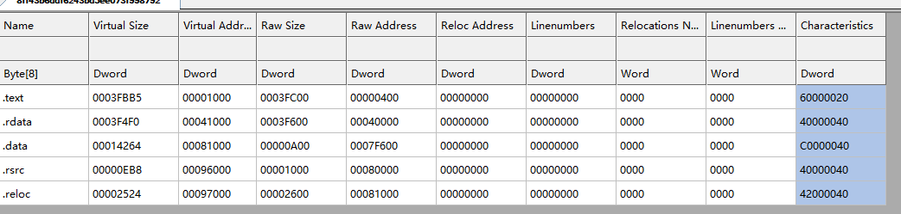

回顾一下

- `0x00000020` (CODE)：该节区包含代码。
- `0x00000040` (INITIALIZED_DATA)：该节区包含已初始化的数据。
- `0x00000080` (UNINITIALIZED_DATA)：该节区包含未初始化的数据（如 `.bss`）。
- `0x02000000` (DISCARDABLE)：该节区在进程启动后可以被丢弃（如 `.reloc` 重定位节，释放内存）。
- `0x20000000` (EXECUTE)：可执行。
- `0x40000000` (READ)：可读。
- `0x80000000` (WRITE)：可写。

发现data段可读写执行，可疑

### dll调试

考虑到DllMain正常来说会有很多反调试逻辑，

结合导出表的函数，可以使用x32dbg调试导出函数逻辑

使用方法：打开x32dbg

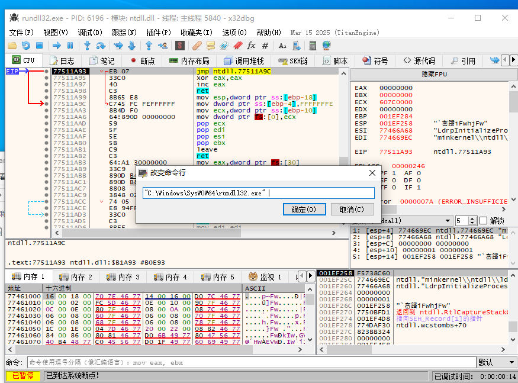

先选择这个rundll32程序再改变命令行，把样本放上去，第三个参数是函数名字，可以精准调试Callrun这个函数，然后再一些经典函数下断点

▪ VirtualAlloc (出口点上)
▪ VirtualProtect
▪ ResumeThread

直接

```
bp VirtualAlloc 
bp VirtualProtect 
bp ResumeThread 
```

### 断点dump

VirtualAlloc这个函数申请了内存地址，通常会有代码写到里面，观察此时eax的值

在VirtualAlloc快返回的指令下断点和VirtualProtect 开始的指令下断点

下面是VirtualAlloc的ret前，eax对应内存地址的地方

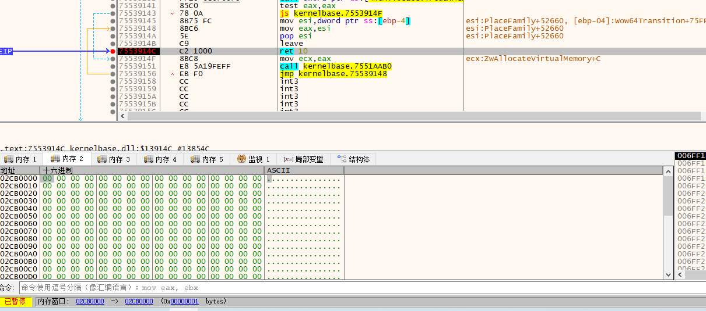

在三次VirtualAlloc的eax都转到内存窗口，第一次断到VirtualProtect 时，发现特征

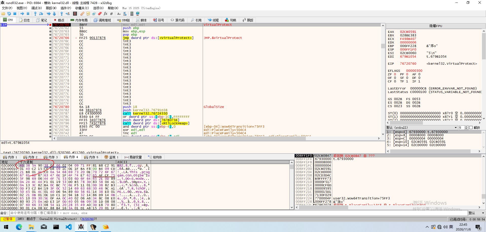

ASCII表示中的前几个字符是“M8Z”，这表明它使用了aPLib压缩（这个网上有标准处理办法）。这时到

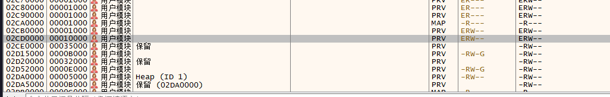

这里把这个右键从内存转到文件，拿到010分析，搜索MZ头

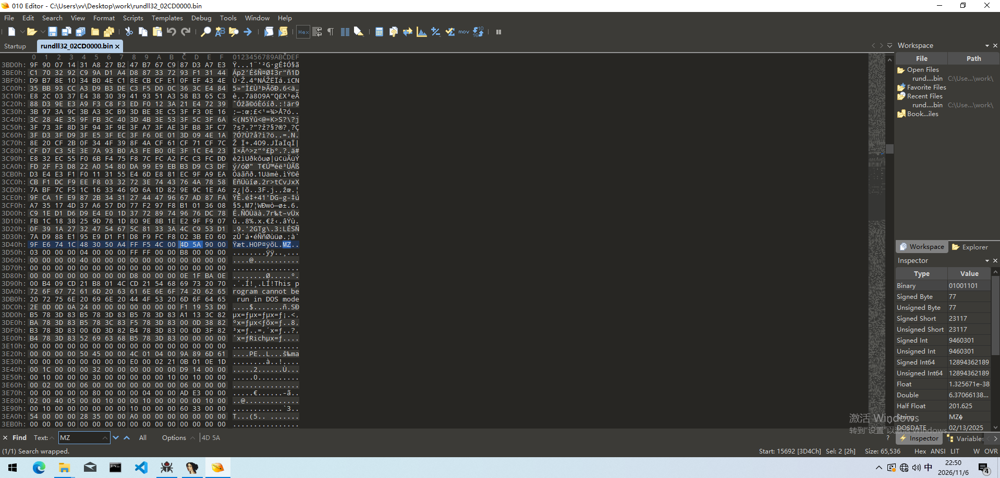

然后将之前的数据都删了然后到pebear看

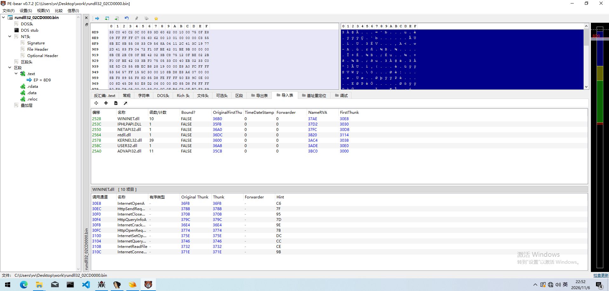

发现wininet了，接下来对这个bin静态分析

### 静态分析

先看data段有什么东西

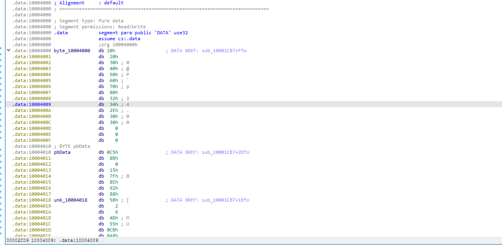

看到三个数值，一个16byte一个8byte，下面是一长串的差不多几千byte

对pbData交叉引用查找，发现在sub_10001CB7作为sub_10002131的参数

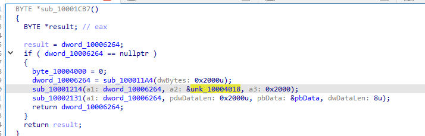

sub_10002131里面点进去是非常多的加密逻辑，先略过，看看有没有其他的信息

现在找主逻辑，在导入表找wininet.dll的函数，这里我选第一个吧

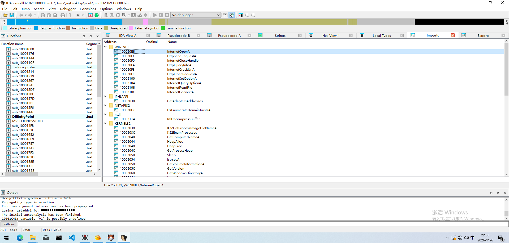

然后点进去，逻辑都挺难看，但是不断通过找函数交叉引用一步步往上找

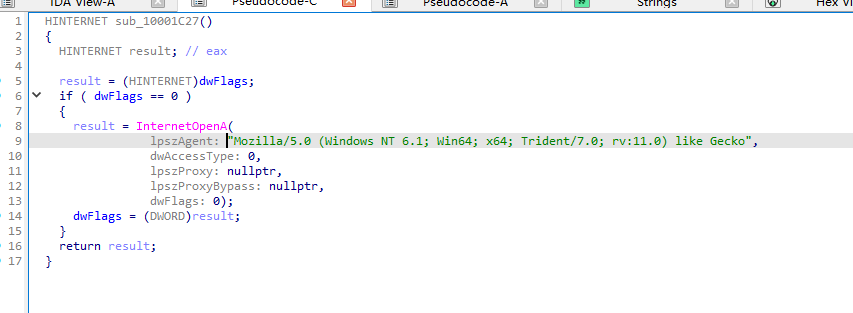

最终

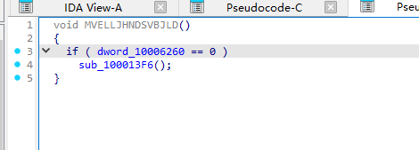

这里到头了，那么核心函数是sub_100013F6，可以命名为main_a

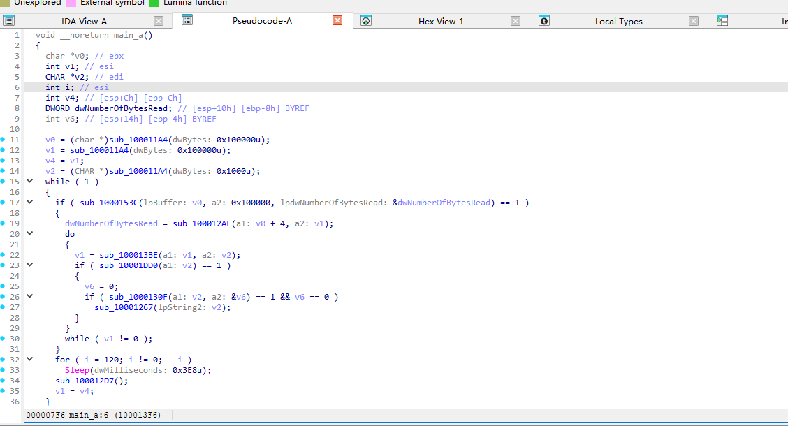

然后一个个看函数

sub_100011A4，传进去0x100000，大概内容就是根据传入的数值，从堆中分配内存，前面可以看作malloc，分配了三个缓冲区

然后下面是一个循环，底下的for每隔120秒循环一次

sub_1000153C看着像readfile，读取失败就跳过继续120秒循环，点进去

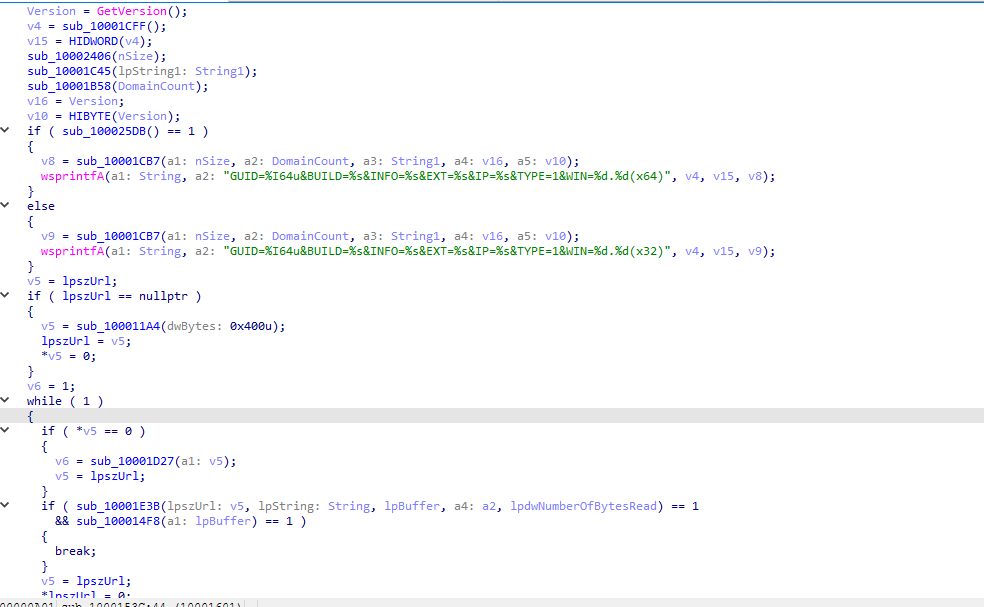

发现并不是读文件，V ersion获取windows版本

sub_10001CFF只调用一次函数点进去，发现GetAdaptersAddresses这个api

获取本地计算机上所有网络适配器（网卡）的详细配置信息，大概可以理解为这个函数是采集设备指纹

sub_10002406函数有获取计算机名字的api， sub_100021F8

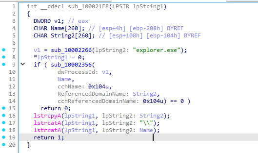

v1获取进程的某些值，sub_10002356是根据v1获取的值获取用户名和域名

整个操作最后拼起来，大概拼成    INFO=DESKTOP-ABC123 @ CORP\Administrator    之类的

sub_10001C45里面涉及到可以读取公网ip的url，可以认为这就是获取公网ip，如果没有返回东西就设置为0.0.0.0继续循环等着

回到外面

sub_10001B58里面有DsEnumerateDomainTrustsA这个api枚举本机域信任关系

无论如何，上面几个函数就是获取本机的一些信息，没必要深究具体怎么实现了，继续分析之前的sub_10001CB7

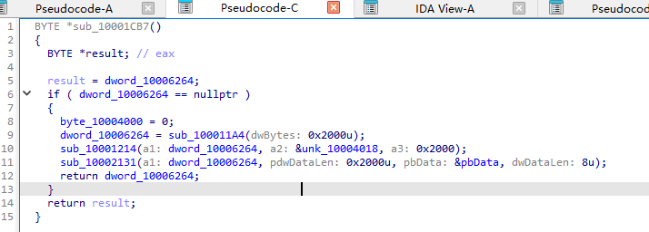

sub_10001214点进去是memcpy，从之前那大块区域选2000字节到dword_10006264上面

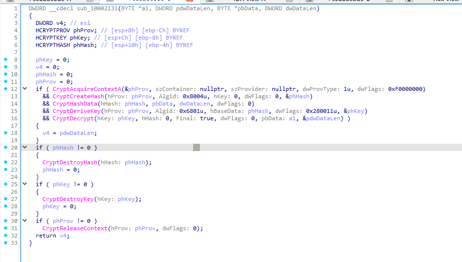

第一个参数是数据，第二个数据长度，第三个密钥，第四个密钥长度

先初始化，然后涉及了很多api，一个个解释

CryptAcquireContextA：获取加密服务提供程序 (CSP) 句柄，1表示需要支持密钥交换、签名、哈希和对称加密的完整 RSA 提供程序，0xF0000000表示不使用持久密钥容器，临时会话

CryptCreateHash：创建哈希对象，0x8004u表示SHA1，hkey=0表示无密钥哈希算法

CryptHashData：对数据哈希，将密钥加到之前的哈希对象，对 pbData 做 SHA1 哈希

CryptDeriveKey：从哈希值派生会话密钥，0x6801u对应CALG_RC4，使用RC4流密码算法，0x280011u为组合标志
0x00000001：CRYPT_EXPORTABLE，表示派生出的密钥可以导出
0x00000010：CRYPT_CREATE_SALT，表示在派生密钥时使用盐值
0x00280000：对应密钥长度。根据文档，dwFlags的高 16 位用于指定密钥长度（以位为单位），即派生40位（5字节）RC4会话密钥

CryptDecrypt：原地解密数据，phkey使用派生的rc4密钥，final:true表示这是解密最后一个块（唯一），a1作为密文传进去，函数返回会更新a1和长度

**总结就是将 pbData 中的数据进行 SHA1 加密 → 结果当作 RC4 的密钥**

逐行解释别人写的解密脚本

### 脚本

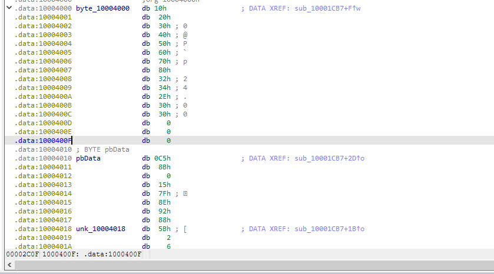

```
import binascii
import hashlib
import pefile
from Crypto.Cipher import ARC4

def extract_data(filename):
    pe = pefile.PE(filename)
    for section in pe.sections:
        if b".data" in section.Name: # data节存在数据和密钥
            return section.get_data()

def data_decryptor(rc4key, encrypted_config):
    rc4_cipher = ARC4.new(rc4key)
    decrypted_config = rc4_cipher.decrypt(encrypted_config)
    return decrypted_config

def main():
    filename = input("Filename: ")
    datasec = extract_data(filename) # 输入PE文件路径，这里传入脱壳的bin

    datasec2 = datasec[16:] # 后面是密钥+密文，前16字节可能是ID之类的东西不用管
    key = datasec2[:8]
    encrypted_data = datasec2[8:256] # 实际只有一小块地方有数据
    hashed_key = hashlib.sha1(key).hexdigest()
    true_key = hashed_key[:10] # 只使用5个字节作密钥

    c2_config = data_decryptor(binascii.unhexlify(true_key), encrypted_data)
    print(c2_config.decode('utf-8'))
    

if __name__ == '__main__':
    main()
```

输出

```
1910_nswhttp://newnucapi.com/8/forum.php|http://gintlyba.ru/8/forum.php|http://stralonz.ru/8/forum.php|
```


当然因为算法比较简单没有什么魔改，直接用cyberchef也可以解出来，注意RC4密钥只取5字节

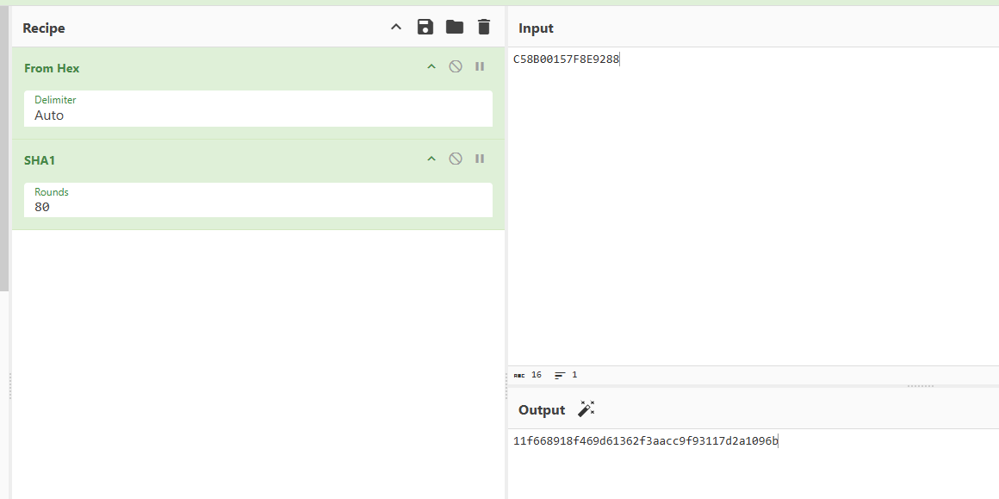

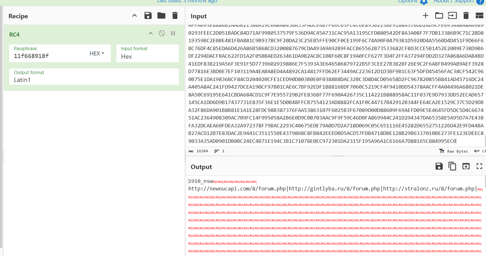


## 静态重新分析

很明显，跟着文章做一次还是有很多疑惑的点，与其问AI解释，不如自己上手过一遍

考虑到别人的博客是经验总结，直接就能想到要调试某个导出函数确实令我糊涂。实际分析的时候还是先拿到ida看壳和加载器具体做了什么才好脱壳，重新分析一次吧

### Dllmain

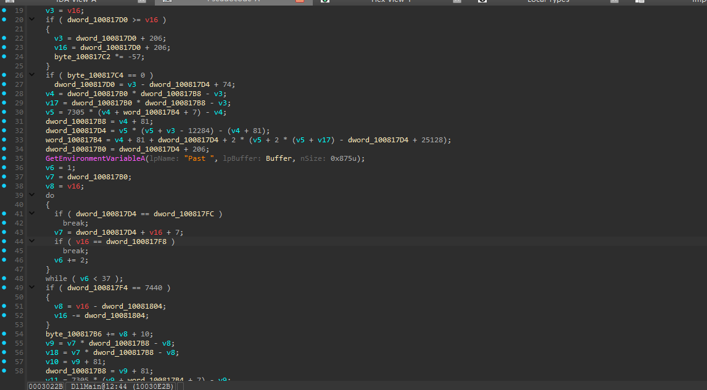

可读性极差，抓住主要逻辑分析——注意要伪代码结合汇编分析，只看伪代码问题有点多

先看函数调用以及参数情况

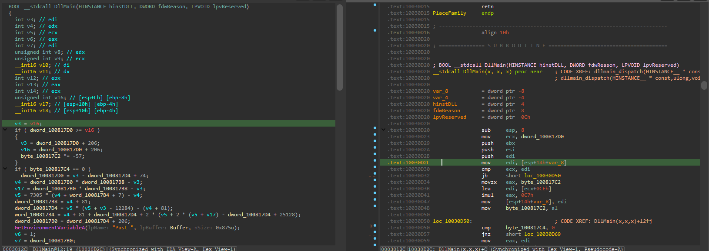

v16在下面没有初始化，v17和v18共用栈，大概率是ida识别出问题了，看汇编
第一行 sub esp,8，开辟栈空间，但是var8是-8，并没有看到esp-8的地方有初始化，故下面的edi读取的是未初始化的值（对应v3赋值）
可以把它当作未知的种子来看，重命名为seed_uninit

下面的dword_100817D0点进去看数值

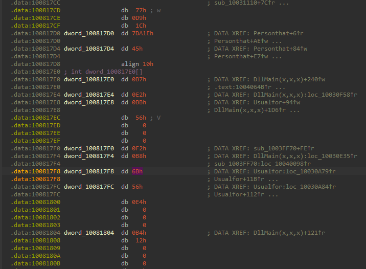

第一段状态说不准，用未知的值做判断，也就是说全局状态依赖运行状态

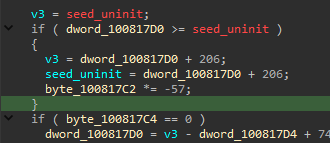

下面还有一大堆计算，现在都先不看，直接看到api

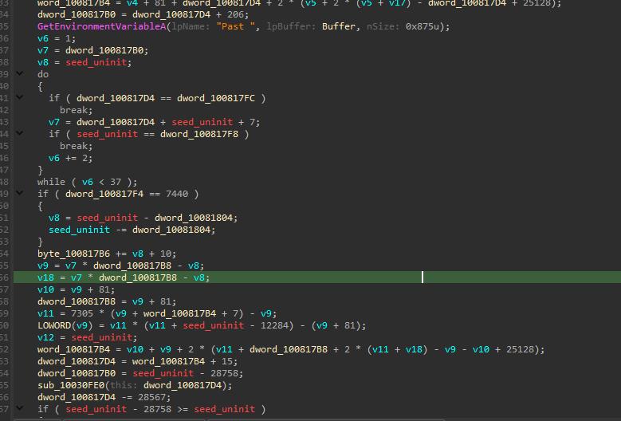

这个api作用是读取名为 "Past " 的环境变量到 Buffer，估计是反沙箱
紧接着下面是一个循环，循环18次，也是一堆计算，没必要看
算术伪代码太多了，我这里直接锁定一个函数，以它为拓展分析

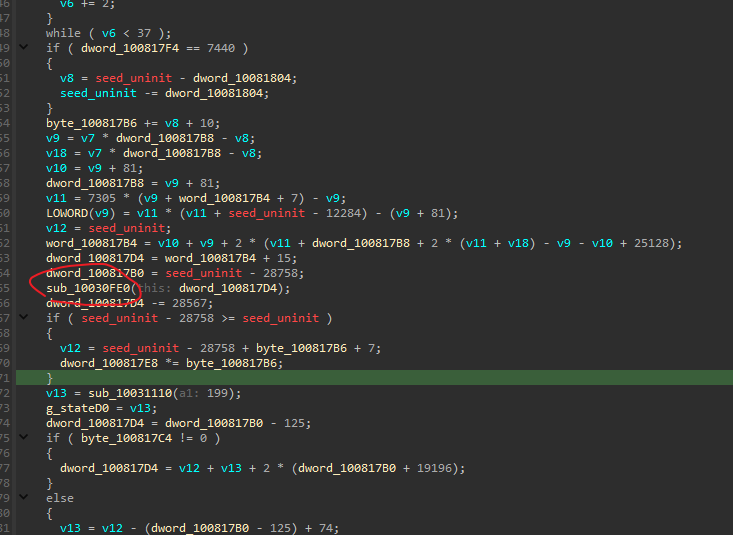

点进去发现里面没有调用别的函数，传入ecx但是没有明显输出，这个可孤立看待

锁定剩下两个函数

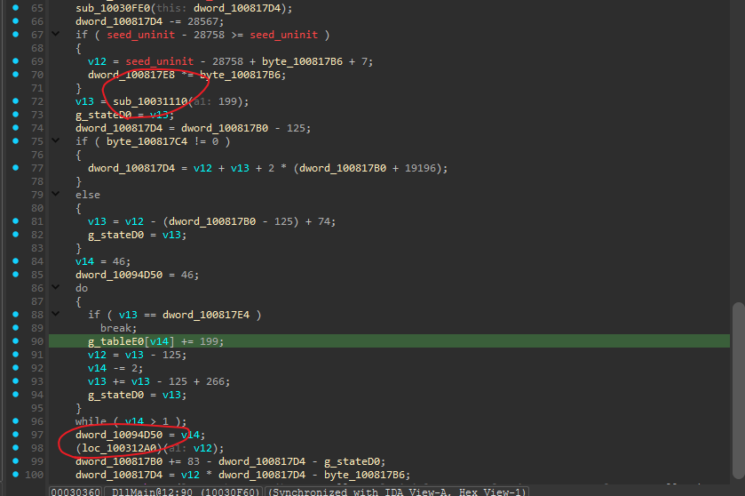

第一个进去，发现返回值v13，但是使用了未初始化的值，分析价值低，直接忽略。第二个没被识别成函数，之后再看

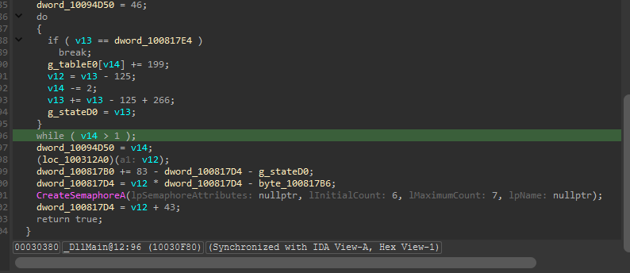

最后也没什么逻辑，调用了api，作用是创建一个匿名的、不可继承的、初始计数为 6、最大计数为 7 的信号量内核对象
但是并没有东西接收返回值，直接忽略

回头看看那个函数

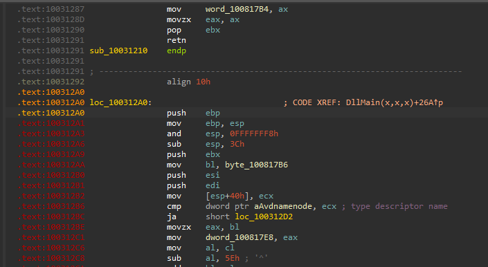

很明显前面已经ret了，这里没被识别成函数，修复一下
直接按P发现没反应，ida返回

```
.text:10032042: The function has undefined instruction/data at the specified address.
Your request has been put in the autoanalysis queue.
```

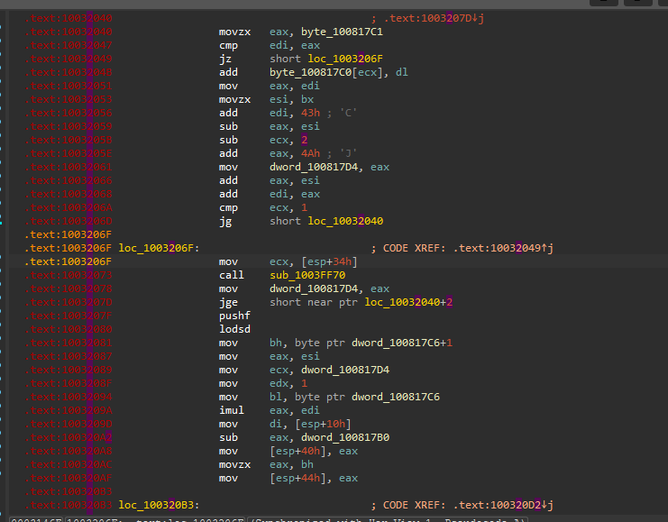

很遗憾这里并没有花指令什么的东西，且下面有一条jge     short near ptr loc_10032040+2
跳进指令中间混淆，让一个代码有两种解释，打乱ida线下反汇编

既然如此只能啃汇编了

### loc_100312A0

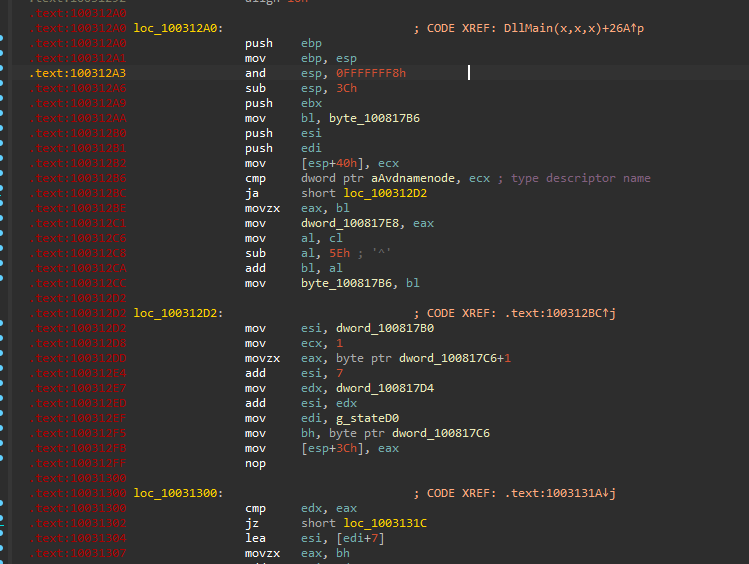

开头先建立标准栈帧，栈按8字节对齐，开0x3C字节局部变量，然后push三个寄存器，接着ecx存入局部变量（[ebp±xx] / [esp+xx] = 栈上（局部或参数）；纯寄存器 = 当前计算）

注意到ecx是传入loc_100312A0的参数——因为call之前的调用如下

```
.text:10030F82                 mov     dword_10094D50, ecx
.text:10030F88                 mov     ecx, ebx
.text:10030F8A                 call    loc_100312A0
```

注意到下面还有很长的一串汇编，此时进行跳读，只记录有函数和与特殊全局变量交互的地方，记得先把之前忽略的函数标记成confusion_n

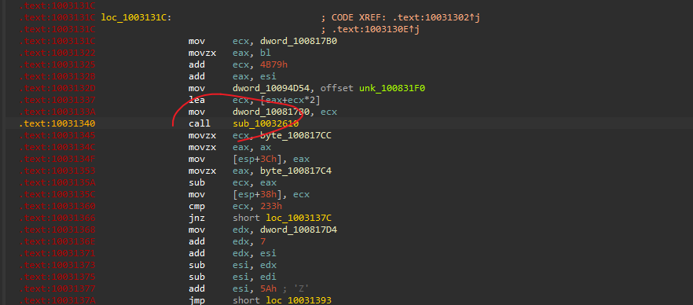

这里发现上面把暂存区地址存入全局变量mov     dword_10094D54, offset unk_100831F0

点进去函数可以看伪代码，没有和外面交互的逻辑，标记为confusion

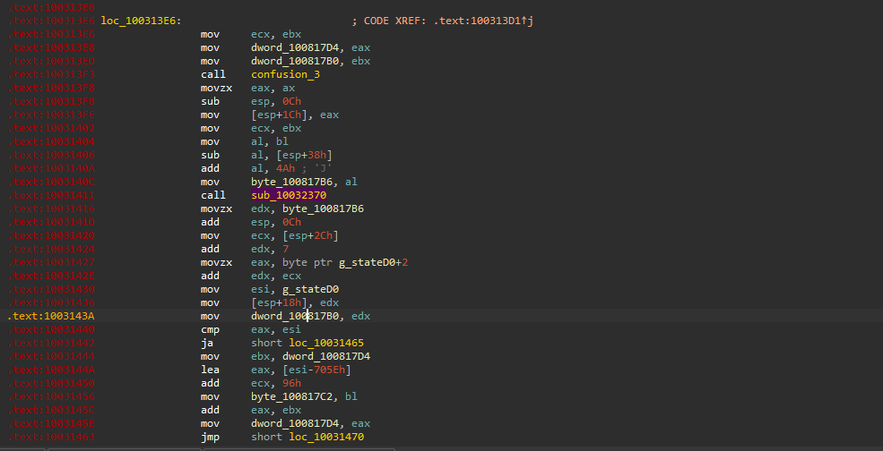

#### sub_10032370

紧接着看到另一个函数，点进去看，这个sub_10032370可以看伪代码

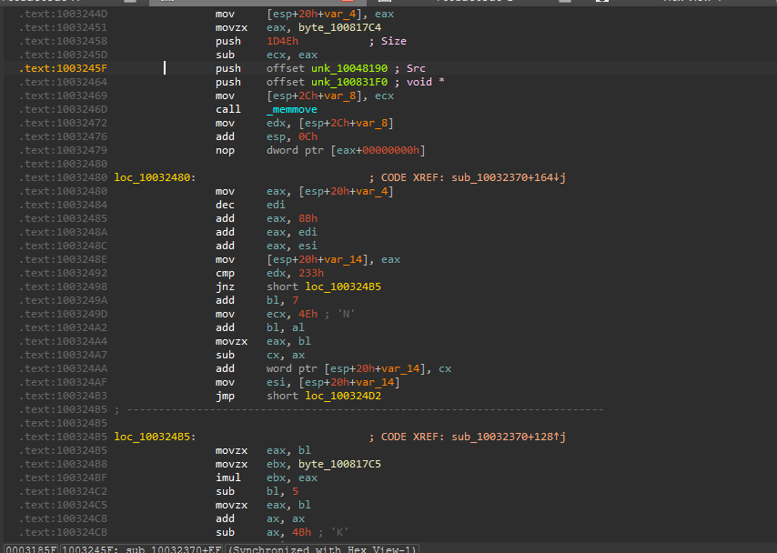

这个函数和unk_100831F0存在交互（memmove(a1: &unk_100831F0, Src: &unk_10048190, Size: 0x1D4Eu);），把unk_10048190（.rdata）的值传入unk_100831F0(.data)，三个push从上到下分别是长度、源、目标

最后mov eax, offset unk_100831F0 意味着返回值是eax，可以重点标记这个函数important_1

然后退出来继续看外面的

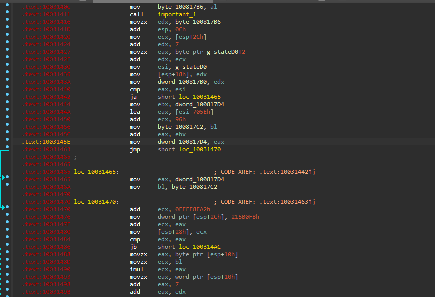

发现mov     dword ptr [esp+2Ch], 215B0FBh这个大常数，但是紧接着的逻辑并没有调用

继续看，接下来一大段都是循环，计数，先跳过

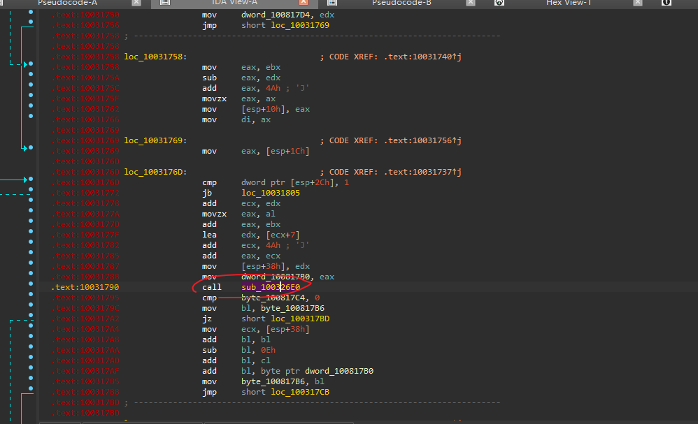

#### sub_100326E0

终于找到一个函数，点进去看

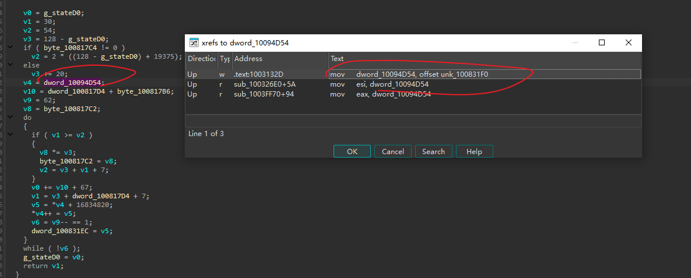

观察到这里用了之前暂存区的地址，v6 = v9-- == 1;这个是先比较后递减，循环62轮（相当于同时对248字节的东西处理）——这里联想到之前博主的解析脚本，也是数据段248字节才有东西

每轮把 dword_10094D54 指向的数组元素加常量 16834820；同时累加 g_stateD0；中间有一个有限次的状态更新块，更新 byte_100817C2 和局部 v2；最后返回 v1

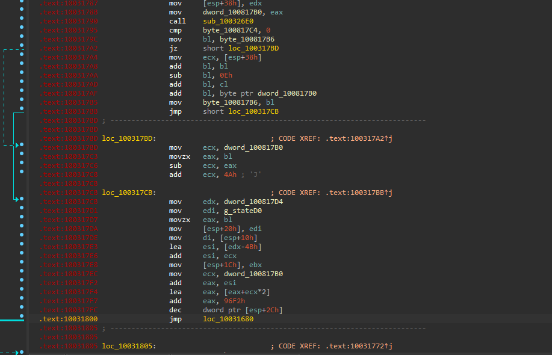

这里有个自减+大跳，是外层循环，循环用的次数是215B0FBh——也就是说上面整块地方就是不断对dword_10094D54 数据段里面的东西计算——推测是解密数据、也可能是混淆

继续看

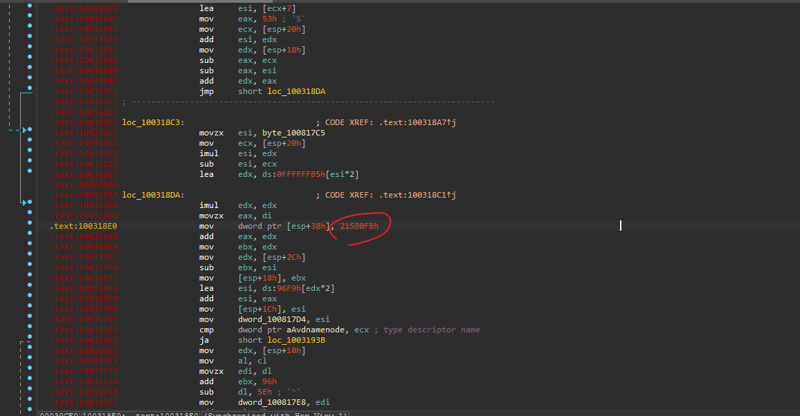

又看到这个大常数了，这次放到[esp+38h]，估计还是循环次数，可以搜索一下在哪结束的alt+t搜索[esp+38h]

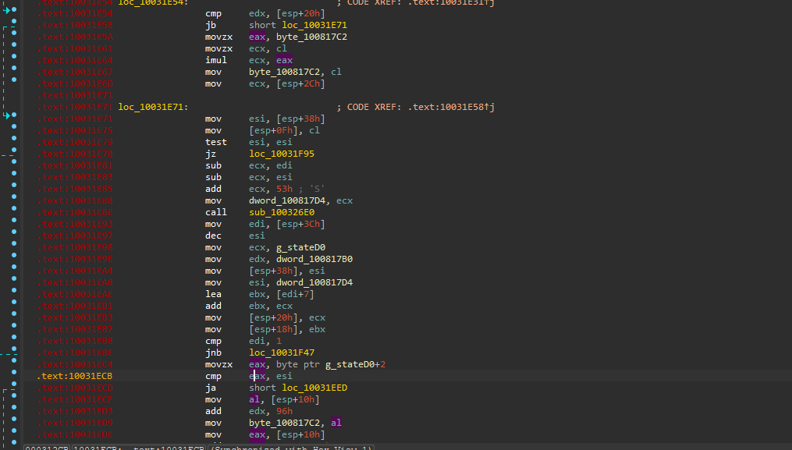

注意到又有一个sub_100326E0，也是循环215B0FBh次

```
.text:10031E71 loc_10031E71:                           ; CODE XREF: .text:10031E58↑j
.text:10031E71                 mov     esi, [esp+38h]
.text:10031E75                 mov     [esp+0Fh], cl
.text:10031E79                 test    esi, esi  # esi==0退出循环
.text:10031E7B                 jz      loc_10031F95
```

回头继续看

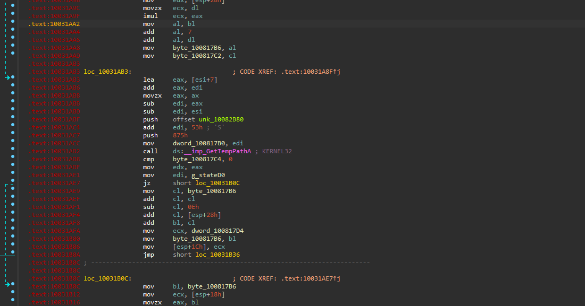

发现有一个api，查询看看是什么

```
DWORD GetTempPathA(
  DWORD nBufferLength,   // 缓冲区大小（字节）
  LPSTR lpBuffer         // 接收临时目录路径的缓冲区
);
获取系统临时目录路径（通常是 %TEMP%，如 C:\Users\xxx\AppData\Local\Temp\），把路径字符串写进 lpBuffer，末尾带反斜杠 \
返回值是字符串大小，DWORD
```

压入unk_10082B80存目录字符串，压入大小875h，但是不知道用来干嘛，先不管

期间遇到一个函数，点进去没看出什么，直接标记了

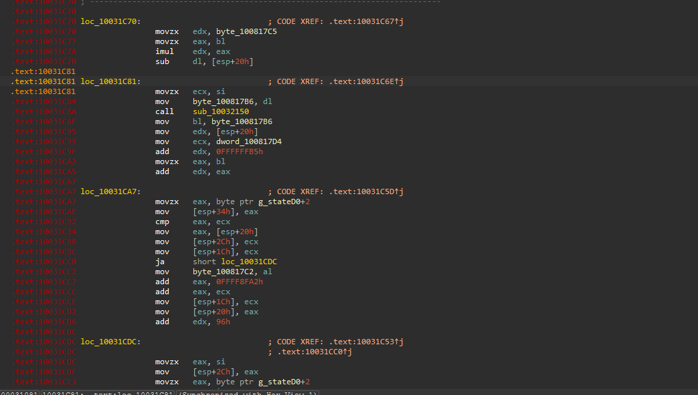

注意到下面的

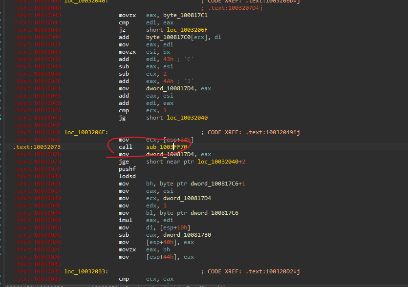

#### sub_1003FF70

这个函数点进去可以看伪代码

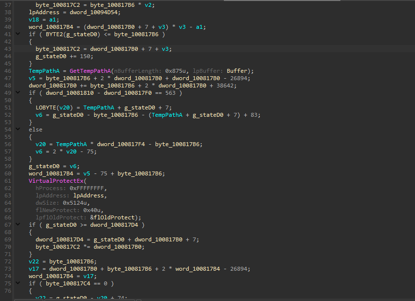

两个api以及dword_10094D54，dword_10094D54被当作lpAddress，估计这就是某个地址之类的

GetTempPathA返回值参与下面的运算

VirtualProtectEx是改权限，看参数

| 参数             | 值                    | 含义                         |
| :--------------- | :-------------------- | :--------------------------- |
| `hProcess`       | `0xFFFFFFFF`          | 当前进程伪句柄               |
| `lpAddress`      | `dword_10094D54`      | 目标内存基址                 |
| `dwSize`         | `0x5124` = 20772 字节 | 要改保护的区域大小           |
| `flNewProtect`   | `0x40`                | **`PAGE_EXECUTE_READWRITE`** |
| `lpflOldProtect` | `&flOldProtect`       | 保存旧保护属性               |

PAGE_EXECUTE_READWRITE是可读可写可执行，准备执行动态解密出的代码

#### 控制流转移

解密完成之后eip应该会转入别的地方执行真实逻辑代码，现在需要找到它在哪里

需要知道**ret = pop eip。所以 push X; ...; ret 等价于 jmp X**

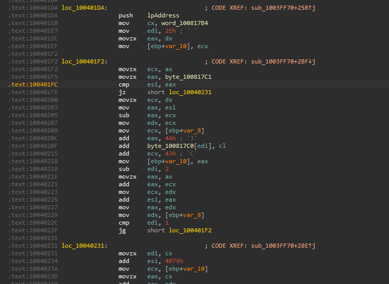

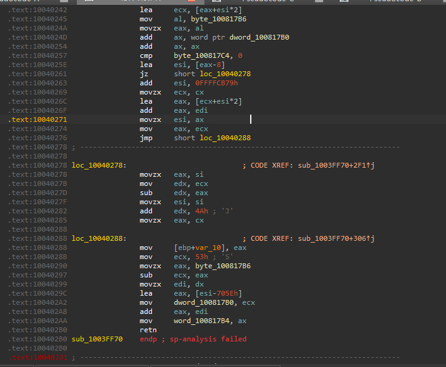

注意到这个函数结束之前push了这个Ipaddress，并且没有mov ebp,esp

这个函数结束就直接跳过去了，现在就是抓住这个时机调试

### 调试

调试指令和之前一样

这次调试方法和之前不一样了，调试主要是找到静态分析遇到的api

先按一次f9到入口，再bp GetEnvironmentVariableA，看到是Past 就证明执行到刚才分析的逻辑了


在内存窗口看一下基址，6A8F0000


#### ①算地址

此时有两种做法，一个是根据静态分析直接算地址跳过去dump，ida分析时最后retn地址是100402B0，402B0则为偏移，实际可以断点停在6A8F0000 + 402B0 = 6A9302B0，直接看等下要跳过去的地方69FB02B0


#### ②断API

二是在VirtualProtectEx的地方下断点，然后在右边的栈窗口跳过去lpAddress把0x1D4E字节的东西dump出来


统一操作

```
savedata "C:\Users\vv\Desktop\work\unpacked.bin", 0x6A9731F0, 0x1D4E
```

但是很遗憾这个并不是PE文件，说不定还有第二层壳，此时把这个bin拖到ida也看不出什么，继续在x32dbg操作吧

当然也可以在ida里面加载这个，看看能不能分析出什么


 0x100831F是样本自己的暂存区虚拟地址，对应

```
0x1003132D  mov  dword_10094D54, offset unk_100831F0   ; 把暂存区地址存进全局
0x10032464  push offset unk_100831F0                   ; memmove 的目的地
0x10040004  mov  eax, dword_10094D54                   ; sub_1003FF70 里读出来
0x1004000C  mov  lpAddress, eax                        ; 送给 VirtualProtectEx + push/ret
```


然而没办法看伪代码，还是先调试吧，x32dbg的汇编肯定是比ida更精确的

#### 汇编分析


call+pop获取当前eip，lea加载一段数据区的内容，ecx是计数器为0x9d9，dx为初始密钥，解密起点是是0x69FF31FA + 0x52 = 0x69FF324C

下面的xor，解密eax一个字节就inc eax，也就是说解密终点是0x69FF324C + 0x9d9 = 0x69FF3C25， loop自减ecx，循环次数也是0x9d9

当然，可以直接看到下面的跳转指令


前面两个都是小跳，最后jmp大跳，直接断点然后运行过去


#### call edi

下面call edi 调用函数指针，跟进去看看


压入四个参数进入69FF337D，ecx计数，esi和edi两个变量，然后下面，每次edi和esi步进四字节，loop循环

跟进69FF337D


看到这些数字有没有感觉，push dword ptr fs:[30] 取模块链表给eax

```
mov eax, [eax+0C]          ; PEB->Ldr
mov ecx, [eax+0C]          ; Ldr->InLoadOrderModuleList.Flink
fs:[0x30] 是 PEB，PEB->Ldr 在 +0x0C，InLoadOrderModuleList 也在 PEB_LDR_DATA + 0x0C。这是遍历已加载模块链表的标准手法
```

然后下面是比较，push 2为比较模式，edi为目标模块名，eax为当前模块名，匹配成功就jmp比下一个——遍历已加载模块，按名字匹配

匹配完之后


```
mov ebx,[eax+3C]         ; DOS Header->e_lfanew
add eax,ebx              ; NT Headers
mov ebx,[eax+78]         ; OptionalHeader.DataDirectory[0].VirtualAddress
add ebx,eax              ; 导出表 VA
mov ecx,[ebx+1C]         ; AddressOfFunctions
mov edx,[ebx+20]         ; AddressOfNames
mov edi,[ebx+18]         ; NumberOfNames
mov ebx,[ebx+24]         ; AddressOfNameOrdinals
add ecx, eax              ; 全部加上 DllBase 转 VA
add edx, eax
add ebx, eax
```

这是解析PE导出表……后面的逻辑可以不看了

总之上面是一个自定义的GetProcAddress，看起来没有使用api而是通过PEB完成读取，能防止被检测到

联系外面的情况

```
69FF37CA  lea esi, [ebx+3F2212]   ; 目标数组
69FF37D0  push esi
69FF37D1  lea esi, [ebx+3F1D1D]   ; 源数组
69FF37D7  push esi
69FF37D8  push 6                  ; 数量
69FF37DA  push 0xD4E88            ; 模块标识/hash
69FF37DF  lea edi, [ebx+3F1DDE]   ; 函数指针 = 69FF3351
69FF37E5  call edi
```

结果就是ebx+3F2212 开始 6 个 dword 被填成 6 个函数地址

这六个函数是什么？回头计算


ebx是0x69FF37A2，然后减3F222F为0x69C01573为基址
0x69C01573+0x003F1C7D=0x69FF31F0   ← 暂存区基址

0x69C01573+0x003F2212=0x69FF3785   ← 输出表（6 个函数指针）


把这些都记下来然后一次跳过去看，发现结果如下

```
0x7515F760  VirtualFree
0x75160760  VirtualProtect
0x7515F7F0  GetProcAddress
0x751618C0  LoadLibraryExA
0x751622F0  FlsFree
0x7515F660  VirtualAlloc
```

估计接下来要用到这些了

看回主逻辑


发现有大量循环，直接跳过

#### 调试VirtualAlloc


这里发现即将调用VirtualAlloc，观察其参数(0, ecx, 0x3000, 0x40)，分配可读可写可执行的内存

bp VirtualAlloc下断点第一次命中，发现内存窗口什么都没有


紧接着下面还是VirtualAlloc，发现依然全0，继续断在VirtualAlloc


第三次执行完依旧是全0，也正常，VirtualAlloc只是分配空间，看看接下来会做什么——由于前两次VirtualAlloc之后都出现rep movsb内存拷贝，但是第三次没有，需要追踪第三次开辟的空间具体被做了什么，于是在02ED0000下硬件写入断点


一次命中，果然有rep movsb，回顾一下这条指令如何运作

```
ESI ：源地址。要拷贝的数据在哪里。
EDI ：目的地址。要把数据拷贝到哪里（通常就是你刚才 VirtualAlloc 返回的地址）。
ECX ：拷贝次数。要拷贝多少个字节。
```

可以直接点击上面的几条指令在右下角看到
ESI  → 0x69FA2904
ECX  → 0x156F
EDI则是2ED0000

再按一次步过


拷贝完了，总之紧盯着这块地方的东西，可以先把断点删了一步步过


这里是loop控制的循环，eax是02ED0000，自增，每个字节与密钥 edx 的最低 8 位（即 dl）进行异或（XOR）运算，并将结果写回原内存

当然，一步步看这些做了什么确实费劲，往后运行算了，函数也不用看，就观察第三次eax处的地方有没有变化


发现经过call B402D5 ，内存窗口数据变化，观察到eax是00B63D4C，估计是解密的输出地址

继续运行


观察到这块地方变成了MZ开头

无论如何，现在可以dump出来看情况了，这和第一次技巧分析的结果已经差不多了

```
savedata "C:\Users\vv\Desktop\work\t.bin", 0xB63D4C, 0x8000
0x8000是这个pe的SizeOfImage
```

不放心可以继续往下运行


可以陆陆续续看到修改权限的函数

之后的分析就和静态差不多了

### 总结

这个样本没有反调试，但是混淆做的几层——至少ida反编译看起来是这样

1. 不重要的全局变量频繁参与运算
2. 不透明谓词 if (byte_100817CC - byte_100817C4 == 563) 这类恒真/恒假分支遍布全篇
3. 地址混淆 + 假函数 
4. 反分析延时（兼第一层解密） ，十几亿次运算，几秒钟运行
5. 反反汇编，跳进之类中间 

